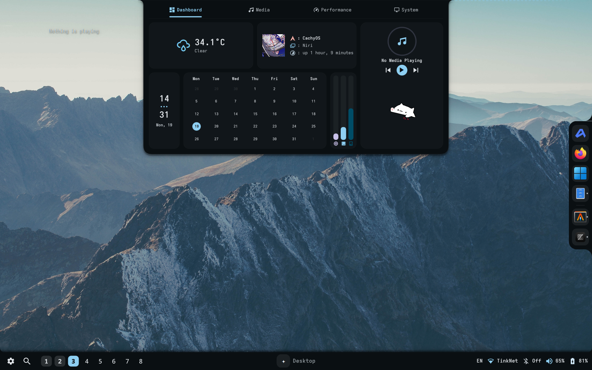
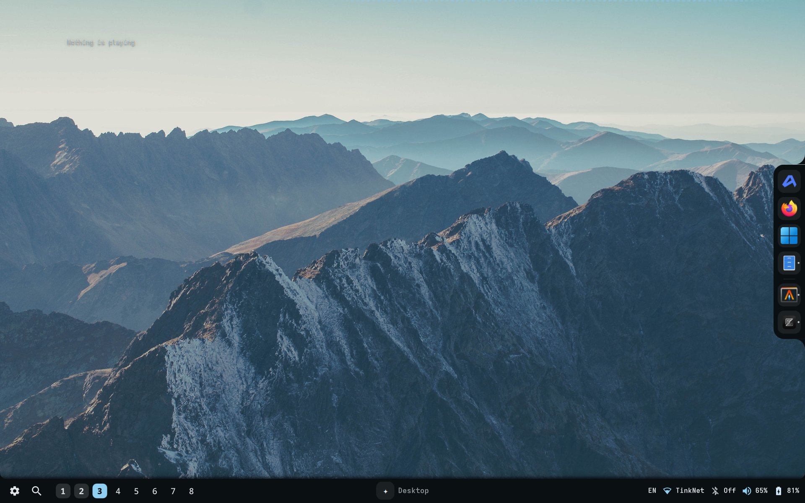
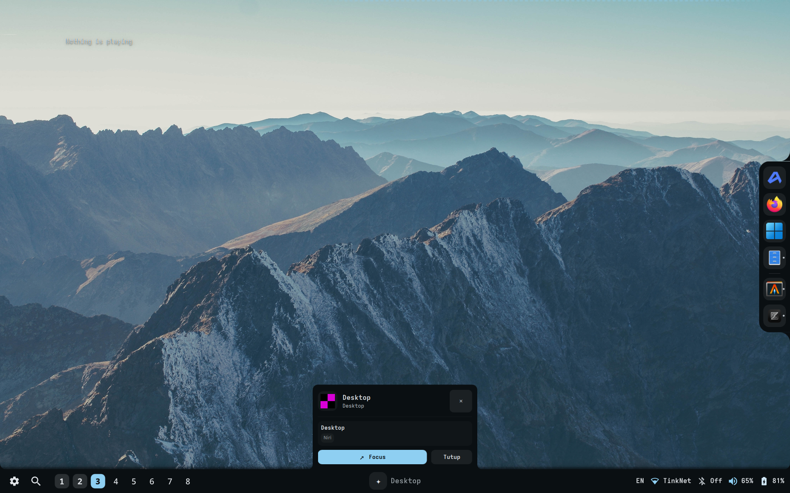

# 💧 Hydronium Desktop Environment & Shell

<p align="center">
  
</p>

<p align="center">
  <b>A personalized, fluid, and modern Wayland desktop experience.</b><br>
  Built with <b>Quickshell</b>, derived from <b>Serpantinum</b> with design inspiration from <b>Caelestia</b>,<br>
  tailored for <b>Niri</b> & <b>Hyprland</b> on <b>Arch Linux</b>.
</p>

<p align="center">
  
  
  
  
  <a href="LICENSE.md"></a>
</p>

<p align="center">
  <a href="#-screenshots-showcase">Screenshots</a> &bull;
  <a href="#-fitur-utama--kustomisasi">Fitur Utama</a> &bull;
  <a href="#-cara-memulihkan--install-di-sistem-baru">Instalasi</a> &bull;
  <a href="#️-pintasan--kontrol">Pintasan</a> &bull;
  <a href="#-struktur-repositori">Struktur</a> &bull;
  <a href="#-credits--acknowledgements">Credits</a>
</p>

---

## 📸 Screenshots Showcase

> Silakan letakkan tangkapan layar desktop Anda ke folder [`screenshots/`](screenshots/) dengan nama berkas di bawah ini:

| Tampilan Desktop Utama | Caelestia Dashboard Notch |
| :---: | :---: |
|  |  |
| *Bidikan layar penuh desktop dengan wallpaper & status bar* | *Dynamic Island yang meluncur turun dari atas layar* |

| Active Window Card (Bar-Attached) |
| :---: |
|  | 
| *Kartu fokus window yang menempel mulus ke bar bawah* |

---

## 🌟 Fitur Utama & Kustomisasi

### 1. 🎛️ Caelestia Dashboard Notch (Top Drop-down Island)
- **Top-Flush Concave Fillets**: Menempel rapi pada bezel atas layar dengan lekukan sudut organik (*concave flare*).
- **Animasi Fluid Spring**: Membuka dan menutup dengan kurva pegas elastis `Easing.OutBack` (`820x400 px`).
- **Tab Navigasi Atas**:
  - `Dashboard`: Tampilan utama grid widget.
  - `Media`: Pemutar musik lengkap dengan seekbar & cover besar.
  - `Performance`: Monitor status CPU, RAM, Disk, Suhu, Jaringan, dan Baterai.
  - `System`: Informasi sistem dan tombol pintasan aksi cepat (*Lock, Reload, Power*).
- **Grid Widget Dashboard**:
  - **Live Weather**: Ikon cuaca dinamis, suhu aktual real-time, dan kondisi cuaca.
  - **User & Distro Card**: Avatar melingkar (`dandadan.jpg`), nama OS, Window Manager (`Niri`), dan uptime.
  - **Digital Clock**: Jam vertikal besar bergaya Caelestia dengan titik tiga (`•••`) dan tanggal.
  - **Monthly Calendar**: Kalender bulanan dengan penanda tanggal hari ini.
  - **Resource Meters**: 3 meteran bar vertikal untuk CPU, RAM, dan Disk.
  - **Caelestia Media Player**: Piringan hitam berputar dengan *circular progress ring*, judul lagu, kontrol pemutar, dan **Bongo Cat** animated GIF yang menabuh drum mengikuti irama lagu!

### 2. 🪟 Universal Active Window Card (Bottom Bar-Attached)
- **Attached to Bar**: Menempel langsung pada garis atas bar bawah tanpa celah (`0 gap`).
- **Organic Fillets**: Sudut bawah menyatu secara organik ke dalam bar menggunakan shader *inverted corner cutout* (`corner_cutout.frag.qsb`).
- **Fluid Morph Animation**: Tinggi mengembang dari bar ke atas dengan cubic easing.
- **Wayland Native**: 100% kompatibel dengan Niri & Hyprland tanpa memerlukan tool tangkapan disk yang lambat atau protocol `hyprland-toplevel-export`.
- **Interactive Masking**: Klik di luar kartu tembus langsung ke aplikasi di bawahnya.

### 3. 🖥️ Universal Arch Linux Compatibility
- **Otomatis Mengenali Distro**: Berjalan mulus di Vanilla Arch Linux, CachyOS, EndeavourOS, Manjaro, dan distro turunan Arch lainnya.
- **Resolusi Direktori XDG Dinamis**: Otomatis mendeteksi folder gambar sistem (`~/Gambar` atau `~/Pictures`) menggunakan `xdg-user-dir`.
- **Auto-Patching Path**: Menyesuaikan path username `$HOME` dan gambar wallpaper secara otomatis saat instalasi.
- **Pembersihan Service Bertabrakan**: Otomatis mencegah service wallpaper luar (`skwd-walld`, `hyprpaper`, dll.) agar tidak berebut layer latar belakang.

---

## 📁 Struktur Repositori

```text
Hydronium/
├── install.sh             # Script instalasi & pemulihan otomatis universal
├── README.md              # Dokumentasi dan panduan lengkap
├── LICENSE.md             # Lisensi sumber terbuka (GNU AGPL v3)
├── .gitignore             # Daftar berkas yang diabaikan Git
├── screenshots/           # Folder tangkapan layar desktop Anda
│   ├── desktop.png        # Screenshot desktop utama
│   ├── notch_dashboard.png# Screenshot Caelestia dashboard notch
│   ├── focus_card.png     # Screenshot kartu active window
│   └── terminal.png       # Screenshot terminal / fastfetch
├── shell/                 # Source code Quickshell & Serpantinum
│   ├── src/quickshell/    # Komponen QML (Notch, Bar, FocusCard, Popouts)
│   ├── src/assets/        # Aset audio, tema, shader, dan bongocat.gif
│   └── src/scripts/       # Script runtime (reload, qs_manager, weather)
├── config/                # Berkas dotfiles (~/.config)
│   ├── serpantinum/       # settings.json
│   ├── hypr/              # Konfigurasi Hyprland Compositor (hyprland.lua)
│   ├── niri/              # Konfigurasi Niri Compositor (config.kdl)
│   ├── kitty/             # Terminal Kitty
│   ├── alacritty/         # Terminal Alacritty
│   ├── waycorner/         # Konfigurasi hot corners
│   ├── fish/              # Shell Fish
│   ├── cava/              # Visualizer audio Cava
│   └── fastfetch/         # Tampilan info sistem
└── wallpapers/            # Wallpaper anime (dandadan.jpg)
```

---

## 🚀 Cara Memulihkan / Install di Sistem Baru

Jika Anda melakukan instalasi ulang sistem, berpindah perangkat, atau mereset konfigurasi:

```bash
# 1. Clone repositori ke komputer Anda
git clone https://github.com/Bountislazy/Hydronium.git ~/Proyek/Hydronium

# 2. Masuk ke direktori
cd ~/Proyek/Hydronium

# 3. Jalankan script restore universal
./install.sh
```

Script [`install.sh`](install.sh) akan bekerja secara otomatis:
1. Memeriksa paket dependensi yang diperlukan via `pacman`, `paru`, atau `yay`.
2. Membuat cadangan konfigurasi lama jika ada.
3. Menyalin source code shell ke `~/.local/share/serpantinum/src`.
4. Mengadaptasi path username dan direktori gambar XDG ke sistem baru Anda.
5. Menonaktifkan service wallpaper yang bertabrakan jika terdeteksi.
6. Menyalin konfigurasi ke `~/.config/` dan wallpaper ke direktori wallpaper sistem.
7. Memuat ulang shell secara otomatis.

---

## ⌨️ Pintasan & Kontrol

| Aksi | Cara Memicu |
| :--- | :--- |
| **Buka Caelestia Dashboard Notch** | Sentuh/arahkan kursor ke atas tengah layar, atau klik pill Notch |
| **Buka Active Window Card** | Klik atau hover judul aplikasi pada bar bawah |
| **Buka Application Launcher** | Klik ikon `✦` pada bar bawah |
| **Tutup Popout / Notch** | Tekan tombol `Escape` atau klik area di luar panel |
| **Muat Ulang Shell Cepat** | Jalankan `bash ~/.local/share/serpantinum/src/scripts/reload.sh` |

---

## 💖 Credits & Acknowledgements

**Hydronium** adalah desktop environment personal yang berdiri di atas karya luar biasa dari komunitas open source Linux & Wayland. Ucapan terima kasih dan apresiasi sebesar-besarnya kepada:

* [**ilyamiro/serpantinum**](https://github.com/ilyamiro/serpantinum) — **Proyek Induk Utama (*Upstream Base*)**. Menyediakan fondasi shell modern, arsitektur modular bar, audio & lyrics engine, panel pengaturan terintegrasi, serta manajemen daemon runtime yang handal.
* [**Caelestia**](https://github.com/caelestia-dots) — **Inspirasi Estetika & Konsep Notch**. Menjadi inspirasi utama bagi desain *Top Drop-down Island*, layout grid widget dashboard, perpaduan warna Catppuccin + Caelestia, dan integrasi animasi Bongo Cat pada pemutar musik.
* [**Quickshell**](https://quickshell.outfoxxed.me/) — Framework QML Wayland mutakhir karya Outfoxxed yang menjadi mesin penggerak seluruh antarmuka shell ini.
* [**Niri**](https://github.com/YaLTeR/niri) — Compositor Wayland *scrollable-tiling* yang sangat fleksibel dan menjadi target utama lingkungan desktop ini.
* [**Hyprland**](https://github.com/hyprwm/Hyprland) — Compositor Wayland dinamis yang didukung secara universal oleh shell ini.
* [**Fastfetch**](https://github.com/fastfetch-cli/fastfetch) & [**Cava**](https://github.com/karlstav/cava) — Utilitas informasi sistem dan visualizer audio terminal yang menghiasi tampilan workspace.

---

<p align="center">
  Dibuat dengan ❤️ oleh <a href="https://github.com/Bountislazy"><b>Bountislazy</b></a> untuk produktivitas dan estetika desktop modern.<br>
  <sub>Berdasarkan fondasi <a href="https://github.com/ilyamiro/serpantinum">Serpantinum</a> & elemen desain <a href="https://github.com/caelestia-dots">Caelestia</a> &bull; Berlisensi <a href="LICENSE.md">GNU AGPL v3</a></sub>
</p>
